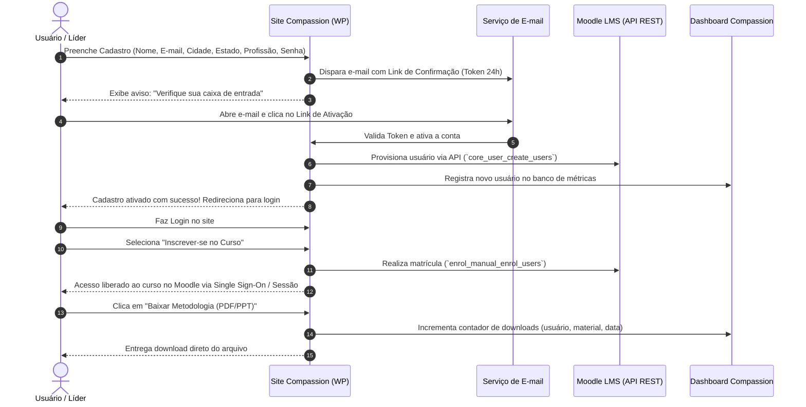

# Plano de Arquitetura & Implementação: Área de Treinamentos e Conexão Moodle LMS
**Projeto:** Compassion Brasil — Portal Institucional & Plataforma de Capacitação  
**Documento Técnico para Alinhamento e Execução**  
**Versão:** 1.0  
**Data:** Outubro de 2026  

---

## 1. Visão Geral e Objetivos do Projeto

A Compassion Brasil atua fortemente capacitando igrejas parceiras, educadores, líderes comunitários e voluntários. A nova **Área de Treinamentos e Recursos Pedagógicos** tem como finalidade conectar de forma transparente o site institucional ao **Moodle LMS**, oferecendo:

1. **Acesso Unificado e Seguro:** Formulário de cadastro direto no site com ativação por e-mail, sem necessidade de cadastros duplicados.
2. **Catálogo Integrado de Conteúdos:**
   - **Cursos Formais (LMS):** Trilha com conteúdos em SCORM, vídeos, avaliações e emissão automatizada de certificado personalizado (nome e data).
   - **Recursos Pedagógicos & Metodologias:** Toolkits de apoio, PDFs, apostilas, planilhas Excel, apresentações PowerPoint e documentos Word disponibilizados para instituições aplicarem em seus contextos locais (sem exigência de certificado, mas com rastreamento de download).
3. **Dashboard de Monitoramento Corporativo:** Painel gerencial para acompanhamento em tempo real de métricas de cadastros, engajamento geográfico/profissional, adesão a cursos e downloads de metodologias, com relatórios exportáveis para a liderança corporativa.

---

## 2. Fluxo de Usuário & Autenticação



### 2.1. Regras de Negócio do Cadastro
- **Campos Obrigatórios:**
  1. **Nome Completo** (armazenado também para composição do certificado oficial)
  2. **E-mail Corporativo/Pessoal** (chave única de autenticação)
  3. **Estado (UF)** (select dinâmico com as 27 UFs)
  4. **Cidade** (select/autocomplete filtrado pelo Estado)
  5. **Profissão / Atuação** (Pastores, Líderes de Ministério Infantil, Educadores Sociais, Voluntários, Outros)
  6. **Senha & Confirmação de Senha** (criptografia padrão WordPress `wp_hash_password`)
- **Validação de E-mail (Double Opt-in):**
  - Ao submeter o formulário, o cadastro é criado com status `pending_verification`.
  - É gerado um hash criptográfico temporário (SHA-256) com expiração de 24 horas.
  - O usuário recebe um e-mail com layout oficial Compassion contendo o botão de ativação.
  - Apenas contas ativadas têm permissão de realizar login, baixar metodologias ou ingressar em cursos.
- **Gestão de Senhas:**
  - Fluxo completo e seguro de recuperação e redefinição de senha (*Forgot Password*), com links descartáveis enviados por e-mail.

---

## 3. Arquitetura Técnica de Integração WordPress ↔ Moodle

O Moodle é executado de forma independente em servidor próprio ou subdomínio dedicado (ex: `cursos.compassion.com.br` ou `ead.compassion.com.br`). A ponte entre o site e o Moodle será estabelecida através dos **Web Services REST oficiais do Moodle**.

```
┌───────────────────────────────────────┐         REST API (JSON)         ┌───────────────────────────────────────┐
│        Site Compassion Brasil         │ ◄─────────────────────────────► │              Moodle LMS               │
│         (WordPress / Nginx)           │   Token Seguro HTTPS (wstoken)  │        (cursos.compassion.com.br)     │
├───────────────────────────────────────┤                                 ├───────────────────────────────────────┤
│ • Formulário de Cadastro & Login      │                                 │ • Mecanismo SCORM / Player de Aulas   │
│ • Vitrine de Cursos & Metodologias    │                                 │ • Matrículas e Trilhas de Aprendizagem│
│ • Repositório de Downloads Protegido  │                                 │ • Emissão de Certificados Dinâmicos   │
│ • Painel / Dashboard Corporativo      │                                 │ • Registros de Conclusão de Módulos   │
└───────────────────────────────────────┘                                 └───────────────────────────────────────┘
```

### 3.1. Funções da API do Moodle Utilizadas

| Função da API Moodle | Método | Finalidade no Portal |
| :--- | :---: | :--- |
| `core_user_get_users_by_field` | `POST` | Verifica se o e-mail já existe no Moodle antes do cadastro |
| `core_user_create_users` | `POST` | Provisiona automaticamente a conta do aluno no Moodle no momento da ativação do e-mail |
| `core_course_get_courses` | `GET` | Sincroniza a listagem de cursos oficiais, categorias e resumos |
| `enrol_manual_enrol_users` | `POST` | Matricula o aluno no curso selecionado com role de Estudante (role id: 5) |
| `core_completion_get_course_completion_status` | `GET` | Consulta o progresso do aluno e se o curso foi concluído com sucesso |
| `mod_customcert_get_customcerts_by_courses` | `GET` | Recupera o certificado emitido contendo o nome e data de conclusão |

### 3.2. Acesso aos Cursos (Single Sign-On / Autenticação Fluida)
Para que o aluno não precise digitar a senha duas vezes ao transitar do site para o Moodle:
- **Abordagem Recomendada:** Utilização de token de acesso temporário gerado pelo WordPress via função `auth_userkey_request_login_url` ou plugin SSO de autenticação federada (SAML/OAuth2 ou External Database Auth).
- Ao clicar em "Acessar Ambiente de Aulas", o usuário é autenticado silenciosamente e entra direto no curso desejado.

---

## 4. Gestão de Conteúdos: Cursos vs. Metodologias

O catálogo na página pública de cursos atenderá a dois tipos de entregáveis:

### 4.1. Cursos no Moodle (Com Certificação)
- **Formatos:** Pacotes interativos SCORM (1.2 / 2004), videoaulas, avaliações e tarefas.
- **Certificado Automatizado:** 
  - Utilização do módulo padrão `mod_customcert` do Moodle.
  - Template oficial da Compassion parametrizado para estampar automaticamente:
    - `{user_fullname}`: Nome completo cadastrado no portal.
    - `{date_completed}`: Data exata da conclusão da trilha formativa.
    - Código de validação / QR Code para verificação de autenticidade.

### 4.2. Metodologias & Recursos de Apoio (Sem Certificação)
- **Formatos:** PDFs informativos, manuais de aplicação de projetos, apresentações em PPTX, apostilas em DOCX e planilhas orçamentárias/pedagógicas em XLSX.
- **Distribuição:** Hospedados no repositório de mídia protegido da Compassion.
- **Acesso:** O botão "Baixar Recurso" dispara uma rota interna do site (`/api/v1/download/?recurso_id=X`) que:
  1. Confirma se o usuário está logado.
  2. Registra o evento de download no banco de métricas (ID do usuário, cargo/profissão, cidade, estado, ID do material).
  3. Entrega o arquivo binário com streaming direto.

---

## 5. Dashboard de Monitoramento Corporativo

O painel administrativo e de liderança será incorporado com foco em tomadas de decisão e prestação de contas.

### 5.1. Indicadores Chave de Desempenho (KPIs de Topo)
1. **Total de Alunos / Líderes Cadastrados** (com taxa de crescimento mensal).
2. **Total de Matrículas Ativas em Cursos**.
3. **Total de Metodologias & Materiais Baixados**.
4. **Certificados Emitidos** (taxa de conclusão de capacitação).
5. **Alcance Geográfico** (quantidade de estados e cidades impactadas).

### 5.2. Visualizações & Gráficos
- **Gráfico de Evolução:** Inscrições e Downloads mês a mês.
- **Distribuição por Segmento Profissional:** Gráfico em rosca (Pastores vs. Educadores Sociais vs. Líderes de Ministério vs. Outros).
- **Mapa de Calor / Distribuição por Região:** Gráfico em barras dos estados com maior engajamento.
- **Tabela de Destaques:**
  - Top Cursos com maior volume de inscritos.
  - Top Metodologias mais requisitadas por outras instituições.

### 5.3. Módulo de Relatórios e Exportação
- Filtros por: Período (Últimos 30 dias, Trimestre, Ano), Categoria de Conteúdo, Estado e Profissão.
- Botão de exportação instantânea:
  - **CSV / Planilha Excel:** Para auditorias e consolidação interna.
  - **Relatório Executivo em PDF:** Diagramação formal com a identidade da Compassion pronta para reuniões de diretoria.

---

## 6. O que Precisamos da Equipe do Moodle (Alexandre)

Para viabilizar a conexão entre o site e o Moodle, solicitaremos ao Alexandre ou ao administrador técnico da hospedagem do Moodle os seguintes acessos e configurações:

### Checklist de Configuração no Moodle:
- [ ] **1. URL Base do Moodle:** Confirmação do subdomínio oficial (ex: `https://cursos.compassion.com.br`).
- [ ] **2. Ativação de Web Services:**
  - Caminho no Moodle: `Administração do site > Recursos avançados > Habilitar serviços web` (Marcar como Ativo).
- [ ] **3. Ativação do Protocolo REST:**
  - Caminho: `Administração do site > Servidores > Serviços Web > Gerenciar protocolos` (Ativar protocolo **REST**).
- [ ] **4. Criação de Serviço Externo:**
  - Caminho: `Serviços Web > Serviços externos > Adicionar`.
  - Nome: `Compassion Site Integration`.
  - Adicionar as funções listadas no tópico 3.1 deste documento.
- [ ] **5. Usuário de Integração (Webservice User):**
  - Criação de um usuário de sistema (ex: `api_wordpress_integration`) com permissões administrativas para gerenciar matrículas e usuários.
- [ ] **6. Geração do Token de Segurança:**
  - Caminho: `Serviços Web > Gerenciar tokens > Adicionar token`.
  - Envio seguro da chave de 32 caracteres (`wstoken`) para os desenvolvedores do portal.
- [ ] **7. Certificado de Conclusão:**
  - Instalação e template do plugin `mod_customcert` ou módulo similar utilizado atualmente pela Compassion.
- [ ] **8. Regras de Firewall / IP Whitelist:**
  - Se houver firewall (Cloudflare, AWS WAF ou fail2ban) na hospedagem do Moodle, liberar requisições originadas do IP do servidor do site principal.

---

## 7. Estrutura de Telas a Apresentar na Reunião de Validação

Para a reunião de amanhã com o Alexandre, apresentaremos a interface interativa com dados simulados (*mock data*) para aprovação do fluxo:

1. **Página Pública de Cursos & Metodologias:**
   - Filtros rápidos: `Todos`, `Cursos Online`, `Metodologias & Guias`, `Materiais SCORM`.
   - Cards visuais com indicação clara: "Curso com Certificado" ou "Material Didático para Download".
2. **Modal / Tela de Cadastro e Login:**
   - Formulário limpo com os campos solicitados (Nome, Estado, Cidade, Profissão, E-mail, Senha).
   - Tela de confirmação: *"Enviamos um e-mail de ativação para você"*.
3. **Área do Aluno ("Meu Espaço de Aprendizado"):**
   - Cursos em andamento com barra de progresso.
   - Botão para download de certificados já conquistados.
   - Histórico de metodologias baixadas com links rápidos.
4. **Dashboard Corporativo do Administrador:**
   - Painel com cards de estatísticas, gráficos dinâmicos de alunos/downloads e visualização da tabela de relatórios exportáveis.
